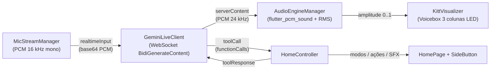

# K.I.T.T. Gemini

Aplicativo Flutter inspirado no **K.I.T.T. (Knight Industries Two Thousand — *Knight Rider*)**, integrado à **Gemini Live API** (`BidiGenerateContent` via WebSocket) com áudio bidirecional nativo em tempo real, *Function Calling* para comandos do painel e Voicebox clássico de 3 colunas LED animado pela amplitude PCM da fala.

---

## Arquitetura



### Funcionalidades Principais
- **Voz bidirecional nativa (Gemini Live API):** captura de microfone em PCM 16 kHz mono e resposta falada em streaming PCM 24 kHz sem precisar de STT/TTS externos.
- **Voicebox KITT em tempo real:** cálculo de amplitude RMS por chunk PCM animando as 3 colunas vermelhas de LEDs (`KittVisualizer`).
- **Comandos via *Function Calling*:**
  - `set_drive_mode` (`normal`, `auto_cruise`, `pursuit`)
  - `activate_turbo_boost`
  - `scan_environment` (`area`, `tunnel`, `police_reports`)
  - `call_contact` (`april`, `bonnie`, `devon`)
  - `trigger_system_effect` (`oil`, `air`, `p1`–`p4`, `s1`–`s2`)
- **Persona configurável em tempo real:** modal no painel para ajustar nome do motorista, idioma (`pt-BR` / `en-US`), voz do Gemini (`Charon`, `Fenrir`, `Orus`, `Puck`, `Kore`) e nível de ironia/sarcasmo.
- **Botão de comando por texto:** permite testar respostas e *Function Calling* mesmo sem microfone.

---

## Pré-requisitos e Ferramentas de Build

| Ferramenta | Versão / Requisito | Finalidade |
| --- | --- | --- |
| **Flutter SDK** | 3.22+ (Dart SDK `>=3.4.0 <4.0.0`) | Build, análise estática, testes e execução |
| **JDK (Java)** | **Java 17** | Compilação Android/Gradle (`JavaVersion.VERSION_17`) |
| **Android SDK** | `minSdk 23+`, `compileSdk 34+` (recomendado 35/36) | Compilação do APK e plugins AndroidX |
| **Android Studio / AVD** *(ou celular físico)* | Emulador x86_64/arm64 ou Android com Depuração USB | Execução e testes do aplicativo |
| **Chave Gemini API** | Google AI Studio (`AQ.` ou `AIza...`) | Autenticação no endpoint `generativelanguage.googleapis.com` |

> Para verificar se o ambiente está pronto, execute `flutter doctor -v`.

---

## Dependências (`pubspec.yaml`)

| Pacote | Versão | Função no Projeto |
| --- | --- | --- |
| `web_socket_channel` | `^3.0.1` | Conexão WebSocket com a Gemini Live API (`BidiGenerateContent`) |
| `flutter_pcm_sound` | `^3.1.2` | Reprodução de áudio PCM 16-bit 24 kHz em streaming de baixa latência |
| `record` | `^6.1.1` | Captura contínua do microfone em PCM 16-bit 16 kHz mono |
| `permission_handler` | `^11.3.1` | Solicitação em tempo de execução da permissão `RECORD_AUDIO` |
| `audioplayers` | `^6.1.0` | Reprodução opcional de efeitos sonoros locais (MP3) dos botões |
| `flutter_lints` *(dev)* | `^4.0.0` | Regras de lint e análise estática Dart/Flutter |

### Configurações Android já aplicadas no projeto
- **`android/app/src/main/AndroidManifest.xml`:** permissões `INTERNET` e `RECORD_AUDIO` declaradas.
- **`android/app/build.gradle.kts`:** `minSdk = maxOf(flutter.minSdkVersion, 23)` e JVM target 17.
- **`android/build.gradle.kts`:** hook `subprojects` que alinha automaticamente o `compileSdk` de plugins antigos (como `flutter_pcm_sound`, publicado com API 33) ao mesmo `compileSdk` do módulo `:app`.

---

## Estrutura de Diretórios

```text
kitt_gemini/
├── android/                             # Projeto nativo Android/Gradle
├── lib/
│   ├── main.dart                        # Entrypoint e tema escuro/vermelho KITT
│   ├── config/
│   │   └── kitt_persona.dart            # KittConfig (--dart-define), systemInstruction e Tools
│   ├── models/
│   │   └── kitt_state.dart              # DriveMode, LiveConnectionState, KittActionEvent, GeminiToolCall
│   ├── managers/
│   │   ├── gemini_live_client.dart      # Cliente WebSocket Gemini Live API
│   │   ├── audio_engine_manager.dart    # Reprodução PCM 24 kHz, cálculo RMS e SFX locais
│   │   ├── mic_stream_manager.dart      # Streaming de microfone PCM 16 kHz
│   │   └── home_controller.dart         # ChangeNotifier principal e executor de Function Calling
│   ├── pages/
│   │   ├── splash_page.dart             # Tela de boot com scanner animado
│   │   └── home_page.dart               # Painel principal responsivo e modal da persona
│   └── widgets/
│       ├── kitt_visualizer.dart         # Voicebox de 3 colunas LED vermelhas
│       └── side_button.dart             # Botões retroiluminados do painel
├── test/
│   ├── kitt_core_test.dart              # Testes unitários (persona, tools e cálculo RMS PCM)
│   └── widget_test.dart                 # Testes de widget (SplashPage, KittVisualizer, SideButton)
├── pubspec.yaml
├── .gitignore
└── README.md
```

---

## Como Executar e Fazer o Build

### 1. Instalar dependências
```bash
cd /home/carlos/src/kitt/kitt_gemini
flutter pub get
```

### 2. Análise estática e testes automatizados
```bash
flutter analyze
flutter test
```

### 3. Preparar dispositivo ou emulador Android
Liste dispositivos conectados ou inicie um emulador AVD:
```bash
flutter devices
# Ou para listar e iniciar um emulador:
flutter emulators
flutter emulators --launch <id_do_emulador>
```
> **Dica para emulador:** nas configurações do emulador (⋮ → *Microphone*), ative **"Virtual microphone uses host audio input"** para falar com o KITT usando o microfone do computador.

### 4. Executar em modo Debug
Passe a chave da API via `--dart-define` (nunca fixe a chave no código):
```bash
flutter run --dart-define=GEMINI_API_KEY=SUA_CHAVE_AQUI
```

Opcionalmente, sobrescreva o modelo da Gemini Live API:
```bash
flutter run \
  --dart-define=GEMINI_API_KEY=SUA_CHAVE_AQUI \
  --dart-define=GEMINI_LIVE_MODEL=gemini-2.5-flash-native-audio-preview-12-2025
```

### 5. Gerar Build de Release (APK / App Bundle)
```bash
# APK instalável
flutter build apk --release --dart-define=GEMINI_API_KEY=SUA_CHAVE_AQUI

# Android App Bundle (Play Store)
flutter build appbundle --release --dart-define=GEMINI_API_KEY=SUA_CHAVE_AQUI
```

---

## Efeitos Sonoros Locais (Opcional)

O app funciona completamente sem arquivos de mídia extras. Caso queira adicionar efeitos sonoros locais nos botões do painel:
1. Crie `assets/audio/` com arquivos como `normal.mp3`, `auto_cruise.mp3`, `pursuit.mp3`, `turbo_boost.mp3`, `air.mp3`, `oil.mp3`, `p1.mp3`–`p4.mp3`, `s1.mp3`–`s2.mp3`.
2. Descomente o bloco `assets:` em `pubspec.yaml` e execute `flutter pub get`.

## Segurança

- **Nunca versione chaves de API:** utilize `--dart-define` em desenvolvimento.
- Caso distribua o aplicativo para terceiros no futuro, evite embutir a chave no APK — prefira **tokens efêmeros** emitidos por um backend ou **Firebase AI Logic**.
